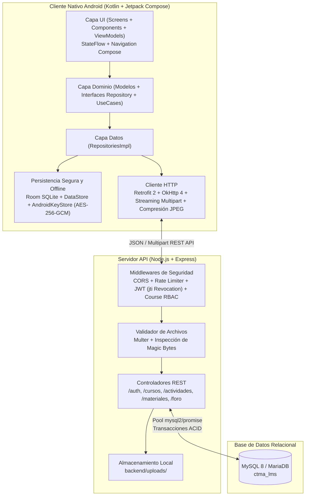

# CTMA Cursos — Gestor de Actividades y Aula Virtual (LMS Android + API Node.js/MySQL)

[](./LICENSE)
[-3DDC84.svg)](./app)
[](./gradle/libs.versions.toml)
[](./backend)

**CTMA Cursos** es una plataforma móvil de gestión del aprendizaje (*Learning Management System - LMS*) inspirada en Google Classroom y adaptada a los flujos académicos del **Centro de Tecnología de la Manufactura Avanzada (CTMA - SENA)**. Combina una aplicación nativa **Android** construida con **Jetpack Compose, MVVM, Clean Architecture, Hilt, Room y Retrofit** con un backend **REST API en Node.js, Express y MySQL relacional**.

---

## Tabla de Contenidos

1. [Características Principales](#1-características-principales)
2. [Arquitectura del Sistema](#2-arquitectura-del-sistema)
3. [Estructura del Proyecto](#3-estructura-del-proyecto)
4. [Modelo de Datos Relacional (MySQL y Room)](#4-modelo-de-datos-relacional-mysql-y-room)
5. [Seguridad y Rendimiento en Producción](#5-seguridad-y-rendimiento-en-producción)
6. [Requisitos Previos](#6-requisitos-previos)
7. [Instalación y Puesta en Marcha](#7-instalación-y-puesta-en-marcha)
8. [Credenciales de Prueba (Seed)](#8-credenciales-de-prueba-seed)
9. [Pruebas Automatizadas](#9-pruebas-automatizadas)
10. [Referencia de Endpoints de la API](#10-referencia-de-endpoints-de-la-api)
11. [Licencia](#11-licencia)

---

## 1. Características Principales

### Autenticación, Roles y Gestión de Cuenta
- **Roles diferenciados (`INSTRUCTOR` y `APRENDIZ`):**
  - El registro como `INSTRUCTOR` valida dominio de correo institucional autorizado (`@sena.edu.co`, `@ctma.edu.co`, `@soy.sena.edu.co`) y soporta código de invitación docente opcional en servidor.
- **Recuperación de contraseña por OTP:** Flujo completo de *«¿Olvidaste tu contraseña?»* mediante código numérico de 6 dígitos con vigencia de 10 minutos (`POST /api/auth/recuperar/solicitar` y `POST /api/auth/recuperar/confirmar`).
- **Autogestión de cuenta (`Mi cuenta`):**
  - Edición de nombre de perfil (`PUT /api/auth/perfil`).
  - Cambio de contraseña validando la clave actual y cerrando otras sesiones activas (`PUT /api/auth/password`).
  - **Eliminación definitiva de cuenta (`DELETE /api/auth/me`):** Cumple con la política de privacidad de Google Play eliminando en cascada al usuario, sus cursos/inscripciones, entregas, mensajes y archivos físicos en el servidor tras confirmar su contraseña.
- **Sesión segura con cifrado en hardware:** El token JWT se almacena cifrado mediante `AES-256-GCM` en el `AndroidKeyStore` (`TokenCryptoManager`) y se invalida explícitamente en servidor al cerrar sesión (`POST /api/auth/logout`).

### Gestión de Cursos
- **Instructores:** Creación de cursos (nombre, código de ficha, programa y descripción) con generación automática de un **código de acceso único de 6 caracteres**, edición, archivado y eliminación de cursos.
- **Aprendices:** Inscripción inmediata a cursos mediante el código de acceso de 6 caracteres (`POST /api/cursos/unirse`) o retiro voluntario del curso.

### Sección 1: Trabajo de Clase (Actividades, Entregas y Materiales)
- **Actividades Evaluables:**
  - Creación y edición de actividades con título, instrucciones, fecha de entrega con selector visual (`DatePickerDialog`) y adjuntos múltiples (archivos y enlaces URL).
  - **Selector de formato de calificación:** Permite elegir exclusivamente entre **Formato 5 puntos (`0 - 5`)** o **Formato 100 puntos (`0 - 100`)**.
- **Entregas de Aprendices:**
  - Envío y actualización de entregas con comentario de texto, múltiples archivos adjuntos (PDF, Office, imágenes, audio, video, ZIP) y enlaces externos.
  - Estados claros de seguimiento: `PENDIENTE`, `ENTREGADO`, `CALIFICADO` y `EXENTO`.
- **Calificación Docente:**
  - Evaluación individual por aprendiz con nota validada según la escala de la actividad (`5` o `100` puntos), opción para marcar como **Exento (`EXENTO`)** y retroalimentación escrita.
- **Material de Apoyo:**
  - Publicación de guías, documentos, presentaciones y recursos multimedia con descarga directa al dispositivo y apertura nativa mediante `FileProvider`.

### Sección 2: Foro de Clase y Chat Privado 1 a 1
- **Doble modalidad de conversación:**
  - **Chat Grupal del Curso:** Canal general visible para el instructor y todos los aprendices del curso, con soporte para fijar mensajes destacados (*pinned messages*).
  - **Chat Privado (`1 a 1`):** Conversaciones directas privadas entre cualquier par de integrantes del curso con contador de mensajes pendientes.
- **Barra de composición optimizada:**
  - **Botón desplegable `+` (a la izquierda del campo de texto):** Despliega un menú compacto con las opciones **Imagen**, **Archivo**, **Audio** y **URL** (además de captura directa con cámara).
  - **Campo de mensaje central** con soporte multilínea y previsualización de adjuntos en cola.
  - **Botón de Nota de Voz (`Voz`) a la derecha del campo de texto y a la izquierda del botón Enviar:** Permite grabar notas de voz en formato `.m4a` (`AAC`) con indicador de tiempo en vivo.
- **Experiencia multimedia enriquecida:**
  - **Visor de imágenes a pantalla completa con Zoom:** Al tocar cualquier imagen adjunta en el chat se abre un visor inmersivo con soporte para *pinch-to-zoom* (`1x` a `5x`), paneo libre y *doble toque* para acercar/restablecer.
  - **Compresión automática de imágenes:** Las fotos capturadas con la cámara o seleccionadas de la galería se redimensionan (máx. `1600 px`) y comprimen en segundo plano (`JPEG 82%`) antes de subirse para ahorrar datos móviles.
  - **Reproductor de audio integrado:** Reproducción inline de notas de voz y archivos de audio con control de pausa/avance.
- **Tiempo real y resiliencia:**
  - Sincronización incremental automática cada **5 segundos** mientras la pestaña Foro está abierta.
  - Reintento automático transparente con *backoff* cuando ocurre un micro-corte de red al enviar un mensaje.

### Sección 3: Personas
- Directorio organizado del curso separado en **Instructor** y **Compañeros de clase (Aprendices)**.
- Acceso directo con un toque para iniciar un chat privado 1 a 1 con cualquier integrante.
- Opción para que el instructor agregue aprendices por correo electrónico o retire integrantes del curso.

### Sección 4: Notas (Libro de Calificaciones y Exportación Excel)
- **Tabla Matricial de Calificaciones (a la derecha de la pestaña Personas):**
  - Muestra cada integrante del curso en las filas y cada actividad evaluable en las columnas con su nota obtenida (`Calificado`, `Exento`, `Entregado` o `Pendiente`), además de la columna fija **Total** con el promedio ponderado tanto en escala sobre **`5.0`** como sobre **`100`**.
  - Los instructores visualizan la sábana completa de toda la clase; los aprendices visualizan su propio consolidado detallado.
- **Exportación a Excel (`.xlsx`):**
  - Botón **Exportar Excel** que genera localmente un libro OpenXML `.xlsx` nativo (con estilos de encabezado, notas por actividad y promedios finales) listo para abrir o compartir en Microsoft Excel, Google Sheets o LibreOffice Calc.

### Notificaciones Locales, Caché Offline y Diagnóstico
- **Notificaciones del sistema (`NotificadorLocal`):** Avisa automáticamente en la barra de estado de Android cuando se detectan nuevas actividades publicadas, nuevas calificaciones/exenciones o nuevos mensajes en el foro.
- **Modo Offline-First con Room:** Los cursos, actividades y materiales se persisten en SQLite (`Room`) para consulta inmediata sin conexión.
- **Tema Cálido (`Warm Light` / `Warm Dark`):** Interfaz Material 3 adaptable con conmutador de tema claro/oscuro persistente en `DataStore`.
- **Registro local de fallos (`Crash Logger`):** Cualquier excepción no controlada del hilo principal se guarda automáticamente en `filesDir/crash_logs/ultimo_crash.log` para diagnóstico sin depender de servicios externos.

---

## 2. Arquitectura del Sistema

El proyecto sigue **Clean Architecture + MVVM (Model-View-ViewModel)** con flujo de datos unidireccional (`UDF`) mediante `StateFlow` y corrutinas de Kotlin en el cliente Android, comunicándose con una API RESTful modular en Node.js/Express respaldada por MySQL.



### Stack Tecnológico

| Capa | Tecnologías y Librerías |
| :--- | :--- |
| **UI Android** | Jetpack Compose (Material 3), Navigation Compose (`2.8.5`), Material Icons Extended, `LruCache` para imágenes |
| **Arquitectura y DI** | MVVM, Clean Architecture, Dagger Hilt (`2.52`), Kotlin Coroutines & `StateFlow` (`1.9.0`) |
| **Datos y Seguridad Android** | Room (`2.6.1`), Preferences DataStore (`1.1.1`), `AndroidKeyStore` (`AES/GCM/NoPadding`), `FileProvider` |
| **Red y Serialización** | Retrofit (`2.11.0`), OkHttp (`4.12.0`), Kotlinx Serialization JSON (`1.7.3`) |
| **Backend API** | Node.js (ES Modules), Express (`4.21`), `mysql2/promise` (`3.11`), `jsonwebtoken` (`9.0.2`), `bcryptjs`, `multer`, `cors` |
| **Base de Datos** | MySQL 8.0+ / MariaDB 10.6+ (UTF-8 `utf8mb4_unicode_ci`) |

---

## 3. Estructura del Proyecto

```text
Gestor-Actividades-CTMA/
├── app/                                       # Módulo nativo Android
│   ├── schemas/                               # Esquemas exportados de Room
│   └── src/
│       ├── main/
│       │   ├── AndroidManifest.xml            # Permisos, FileProvider y reglas de backup
│       │   ├── java/com/example/labo_android_semana_02/
│       │   │   ├── GestorActividadesApp.kt    # @HiltAndroidApp, NotificadorLocal y CrashLogger
│       │   │   ├── MainActivity.kt            # Punto de entrada y permisos runtime
│       │   │   ├── data/
│       │   │   │   ├── local/
│       │   │   │   │   ├── dao/               # LmsDao (consultas reactivas Room)
│       │   │   │   │   ├── datastore/         # PreferenciasDataStore + TokenCryptoManager (AES-GCM)
│       │   │   │   │   ├── db/                # AppDatabase (Room v6)
│       │   │   │   │   └── entities/          # CursoEntity, ActividadCursoEntity, MaterialCursoEntity
│       │   │   │   ├── remote/
│       │   │   │   │   ├── FileDownloadManager.kt  # Descarga, apertura y limpieza de caché
│       │   │   │   │   ├── MultipartHelper.kt      # Streaming multipart + compresión de imágenes
│       │   │   │   │   ├── api/LmsApis.kt          # Contratos Retrofit (Auth, Curso, Actividad, Foro)
│       │   │   │   │   └── dto/LmsDtos.kt          # DTOs serializables
│       │   │   │   └── repository/
│       │   │   │       └── RepositoriesImpl.kt     # Implementación de repositorios y caché
│       │   │   ├── di/
│       │   │   │   └── AppModule.kt           # Módulos Hilt (OkHttp, Retrofit, Room, Repositorios)
│       │   │   ├── domain/
│       │   │   │   ├── model/Models.kt        # Modelos de dominio inmutables
│       │   │   │   ├── repository/Repositories.kt  # Contratos de repositorios
│       │   │   │   └── usecase/               # Casos de uso y validadores de negocio
│       │   │   └── ui/
│       │   │       ├── components/
│       │   │       │   ├── AdjuntosComponents.kt   # Selectores de archivos, cámara y enlaces
│       │   │       │   ├── AudioRecorderSheet.kt   # Grabadora de voz y reproductor inline
│       │   │       │   ├── ChatForoComponents.kt   # Chat, menú '+', visor zoom, tabla Notas y Excel
│       │   │       │   └── DialogoCalificarConEscala.kt
│       │   │       ├── navigation/AppNavigation.kt # Grafo de navegación Compose
│       │   │       ├── screens/
│       │   │       │   ├── AuthScreen.kt           # Login, Registro y Recuperación OTP
│       │   │       │   ├── CursosScreen.kt         # Mis Cursos y diálogo Mi Cuenta
│       │   │       │   ├── CursoPanelScreen.kt     # Trabajo, Foro, Personas y Notas
│       │   │       │   └── ActividadDetalleScreen.kt # Entregas y calificación docente
│       │   │       ├── theme/                 # Paleta Warm Light / Warm Dark
│       │   │       └── viewmodel/             # AuthViewModel, CursosViewModel, CursoPanelViewModel, etc.
│       │   └── res/xml/
│       │       ├── backup_rules.xml           # Exclusión de datastore y database en backups
│       │       ├── data_extraction_rules.xml  # Reglas Android 12+ para nube y D2D
│       │       └── file_paths.xml             # Rutas autorizadas para FileProvider
│       └── test/                              # Suite de pruebas unitarias (JUnit 4 + Coroutines Test)
├── backend/                                   # Servidor API REST en Node.js
│   ├── sql/
│   │   └── schema.sql                         # DDL completo de las 10 tablas relacionales MySQL
│   ├── src/
│   │   ├── app.js                             # Configuración Express, CORS, Rate Limit y rutas
│   │   ├── server.js                          # Arranque del servidor HTTP
│   │   ├── config/
│   │   │   ├── db.js                          # Pool de conexiones MySQL
│   │   │   └── env.js                         # Variables de entorno y validación de producción
│   │   ├── middleware/
│   │   │   ├── auth.js                        # Verificación JWT, lista de revocación jti y RBAC
│   │   │   ├── errorHandler.js                # Manejo centralizado de errores y Multer
│   │   │   └── rateLimit.js                   # Limitador de peticiones por ventana deslizante
│   │   ├── routes/
│   │   │   ├── auth.js                        # Registro, login, logout, perfil, OTP y baja de cuenta
│   │   │   ├── cursos.js                      # CRUD de cursos, código de acceso e integrantes
│   │   │   ├── actividades.js                 # Actividades, entregas, calificaciones y sábana de notas
│   │   │   ├── materiales.js                  # Material de apoyo del curso
│   │   │   └── foro.js                        # Foro grupal y mensajes privados paginados
│   │   ├── scripts/
│   │   │   ├── initDb.js                      # Inicializador automático de esquema SQL
│   │   │   └── seed.js                        # Poblado de datos de demostración CTMA
│   │   └── utils/
│   │       └── filePolicy.js                  # Política MIME, limpieza de disco e inspección Magic Bytes
│   └── tests/
│       └── api.test.js                        # Pruebas de políticas de archivos y utilidades
├── CHANGELOG.md                               # Historial detallado de versiones y cambios
├── LICENSE                                    # Licencia GNU General Public License v3.0
└── README.md                                  # Documentación general del proyecto
```

---

## 4. Modelo de Datos Relacional (MySQL y Room)

La base de datos `ctma_lms` en [backend/sql/schema.sql](file:///c:/Users/JuanMa3331/Downloads/WorkSpace%20-%20ADSO/Gestor-Actividades-CTMA/backend/sql/schema.sql) consta de **10 tablas normalizadas** con integridad referencial (`ON DELETE CASCADE`):

1. **`usuarios`**: Cuentas de `INSTRUCTOR` y `APRENDIZ` con hash `bcrypt` de contraseña.
2. **`cursos`**: Cursos creados por un instructor con `codigo_acceso` único.
3. **`matriculas`**: Relación muchos-a-muchos entre aprendices y cursos (`UNIQUE(curso_id, aprendiz_id)`).
4. **`actividades`**: Actividades evaluables de un curso con `nota_maxima` (`5.00` o `100.00`) y `fecha_entrega`.
5. **`actividad_adjuntos`**: Archivos y enlaces adjuntos a una actividad.
6. **`entregas`**: Entregas realizadas por cada aprendiz por actividad (`UNIQUE(actividad_id, aprendiz_id)`), estado (`PENDIENTE`, `ENTREGADO`, `CALIFICADO`, `EXENTO`), calificación y retroalimentación.
7. **`entrega_adjuntos`**: Archivos y enlaces adjuntos a la entrega de un aprendiz.
8. **`materiales`**: Material de estudio publicado por el instructor en el curso.
9. **`material_adjuntos`**: Archivos y enlaces asociados a un material de estudio.
10. **`foro_mensajes`** y **`foro_adjuntos`**: Mensajes del foro grupal (`destinatario_id IS NULL`) y del chat privado (`destinatario_id IS NOT NULL`), con soporte para respuestas anidadas (`parent_id`), fijado (`fijado`) y adjuntos multimedia.

---

## 5. Seguridad y Rendimiento en Producción

El proyecto cuenta con controles de ciberseguridad y optimizaciones de alto rendimiento auditados:

### Controles de Ciberseguridad
- **Cifrado de sesión en hardware (`SEC-01`):** El token JWT se cifra con `AES-256-GCM` respaldado por `AndroidKeyStore` antes de guardarse en `DataStore`, y los directorios `datastore` y `database` están excluidos de backups en la nube y transferencias D2D (`backup_rules.xml` y `data_extraction_rules.xml`).
- **Control de rol docente (`SEC-02`):** Validación de correo institucional (`@sena.edu.co`, `@ctma.edu.co`, `@soy.sena.edu.co`) y soporte para código de invitación docente (`INSTRUCTOR_INVITE_CODE`) en registro.
- **Protección contra Fuerza Bruta y DoS (`SEC-03`):** Middleware `rateLimit.js` por IP y ruta (máx. 10 intentos en `/api/auth/login`, 8 en `/api/auth/register`, 5 en `/api/auth/recuperar` y 10 en `/api/cursos/unirse`).
- **Autorización previa a subida e inspección de Magic Bytes (`SEC-04`):** El acceso al curso y el rol se verifican **antes** de que `Multer` escriba bytes en disco, y `validateUploadedFilesMagicBytes` inspecciona la cabecera binaria real para rechazar ejecutables o scripts camuflados (`MZ`, `ELF`, `Mach-O`, `#!/`, `<?php`, `<script`).
- **JWT con revocación y CORS restringido (`SEC-05`):** Tokens con vigencia de 12 horas, identificador único `jti` revocable en `/api/auth/logout` y lista blanca de orígenes CORS.
- **Higiene de caché privada (`SEC-06`):** Al cerrar sesión o cambiar de usuario, la app elimina recursivamente los archivos descargados y las grabaciones de voz temporales de `cacheDir`.

### Optimizaciones de Rendimiento
- **Subida de archivos por Streaming (`PERF-01`):** `ContentUriRequestBody` transmite archivos en bloques de `8 KB` directamente desde el `ContentResolver` sin cargar el archivo completo en la RAM de Android.
- **Compresión de imágenes en segundo plano:** Reducción automática de resolución y peso en capturas fotográficas antes de enviarlas por red.
- **Eliminación de consultas `N+1` (`PERF-02`):** El consolidado de notas y actividades agrupa adjuntos y conteos en consultas `WHERE ... IN (...)` en lugar de ejecutar subconsultas por fila.
- **Caché de imágenes en memoria (`PERF-03`):** `RemoteImageAttachmentPreview` utiliza un `LruCache<String, ImageBitmap>` de `20 MB` con submuestreo `inSampleSize` para evitar recomposiciones lentas y `OutOfMemoryError` al hacer scroll en el chat.
- **Paginación en el Foro (`PERF-04`):** `GET /api/cursos/:cursoId/foro` soporta paginación por ventana (`limit` y `beforeId`).
- **Interceptor HTTP no bloqueante (`PERF-05`):** El token JWT se mantiene sincronizado en una referencia `@Volatile` en memoria para que el hilo de red de OkHttp nunca se bloquee leyendo disco.

---

## 6. Requisitos Previos

- **Entorno Backend y Base de Datos:**
  - **Node.js** `v18.18+` o `v20+` (con `npm`).
  - **MySQL** `8.0+` o **MariaDB** `10.6+` (puedes usar **XAMPP**, **Laragon**, **MySQL Workbench** o Docker).
- **Entorno Android:**
  - **Android Studio** Ladybug / Meerkat o superior.
  - **JDK 17** o **JDK 21** (incluido con Android Studio en `jbr`).
  - Dispositivo físico o Emulador Android con **API 24 (Android 7.0)** o superior.

---

## 7. Instalación y Puesta en Marcha

### Paso 1: Clonar el repositorio

```bash
git clone <URL_DEL_REPOSITORIO>
cd Gestor-Actividades-CTMA
git checkout feat/JMCM
```

### Paso 2: Configurar e iniciar la Base de Datos y el Backend

1. Asegúrate de que el servicio **MySQL** esté activo (por ejemplo, iniciando *MySQL* desde el panel de control de **XAMPP** en el puerto `3306`).
2. Entra a la carpeta `backend` e instala las dependencias:

```bash
cd backend
npm install
```

3. Crea tu archivo `.env` a partir de `.env.example` (si no existe, el servidor usará valores seguros de desarrollo por defecto):

```env
PORT=3000
DB_HOST=127.0.0.1
DB_PORT=3306
DB_USER=root
DB_PASSWORD=
DB_NAME=ctma_lms
JWT_SECRET=ctma_super_secret_jwt_key_2026_adso
JWT_EXPIRES_IN=12h
CORS_ORIGINS=http://localhost:3000,http://10.0.2.2:3000
# Opcional: exigir código de invitación para registro de instructores
# INSTRUCTOR_INVITE_CODE=CTMA-DOCENTE-2026
```

4. Crea el esquema de base de datos y carga los datos de prueba iniciales (*seed*):

```bash
npm run db:init
npm run seed
```

5. Inicia el servidor API:

```bash
# Modo normal
npm start

# Modo desarrollo con recarga automática
npm run dev
```

El servidor quedará escuchando en `http://0.0.0.0:3000` y podrás verificar su estado en `http://localhost:3000/api/health`.

### Paso 3: Compilar y ejecutar la Aplicación Android

1. Abre la carpeta raíz `Gestor-Actividades-CTMA` en **Android Studio**.
2. **Configuración de la URL del servidor (`API_BASE_URL`):**
   - Por defecto, en [app/build.gradle.kts](file:///c:/Users/JuanMa3331/Downloads/WorkSpace%20-%20ADSO/Gestor-Actividades-CTMA/app/build.gradle.kts) el `buildType` de `debug` apunta automáticamente a `http://10.0.2.2:3000/api/` (la dirección puente del Emulador Android hacia el `localhost` de tu PC).
   - Si vas a probar en un **dispositivo físico por USB**, ejecuta:
     ```bash
     adb reverse tcp:3000 tcp:3000
     ```
     y usa `http://127.0.0.1:3000/api/`, o bien pasa la IP LAN de tu computador al compilar:
     ```bash
     ./gradlew installDebug -PAPI_BASE_URL="http://192.168.1.X:3000/api/"
     ```
3. Ejecuta la aplicación desde Android Studio (**Run 'app'**) o por línea de comandos:

```bash
./gradlew installDebug
```

---

## 8. Credenciales de Prueba (Seed)

Tras ejecutar `npm run seed` en la carpeta `backend/`, tendrás disponibles las siguientes cuentas listas para probar todos los flujos:

| Rol | Nombre | Correo Electrónico | Contraseña |
| :--- | :--- | :--- | :--- |
| **Instructor 1** | Carlos Mendoza (Instructor ADSO) | `instructor@sena.edu.co` | `123456` |
| **Instructor 2** | Laura Gómez (Instructora Base de Datos) | `laura.gomez@sena.edu.co` | `123456` |
| **Aprendiz 1** | Juan Manuel (Aprendiz ADSO) | `aprendiz@sena.edu.co` | `123456` |
| **Aprendiz 2** | María Fernanda Rojas | `maria.rojas@sena.edu.co` | `123456` |
| **Aprendiz 3** | Andrés Felipe Castro | `andres.castro@sena.edu.co` | `123456` |

**Códigos de acceso de los cursos de prueba:**
- **Arquitectura Móvil Android (MVVM + MySQL):** `ADSO01`
- **Diseño de Bases de Datos Relacionales:** `BD2026`

---

## 9. Pruebas Automatizadas

### Pruebas Unitarias y Compilación en Android
Ejecuta la suite de pruebas unitarias de dominio, casos de uso y `ViewModels` (`ValidarArchivoYFormulariosUseCaseTest`, `ViewModelsTest`, `ReglasCalificacionEscalaTest`):

```bash
./gradlew testDebugUnitTest assembleDebug
```

### Pruebas del Backend Node.js
Ejecuta las pruebas de políticas de archivos, sanitización y validación en el backend:

```bash
cd backend
npm test
```

---

## 10. Referencia de Endpoints de la API

| Método | Ruta | Descripción | Acceso |
| :---: | :--- | :--- | :--- |
| `GET` | `/api/health` | Estado de salud del servidor y conexión MySQL | Público |
| `POST` | `/api/auth/register` | Registro de nuevo usuario (`APRENDIZ` / `INSTRUCTOR`) | Público (Rate Limited) |
| `POST` | `/api/auth/login` | Inicio de sesión y emisión de token JWT | Público (Rate Limited) |
| `POST` | `/api/auth/logout` | Cierre de sesión y revocación inmediata del token (`jti`) | Autenticado |
| `GET` | `/api/auth/me` | Obtener datos del perfil autenticado | Autenticado |
| `PUT` | `/api/auth/perfil` | Actualizar nombre del perfil del usuario | Autenticado |
| `PUT` | `/api/auth/password` | Cambiar contraseña validando la contraseña actual | Autenticado |
| `POST` | `/api/auth/recuperar/solicitar` | Solicitar código OTP de 6 dígitos para recuperar clave | Público (Rate Limited) |
| `POST` | `/api/auth/recuperar/confirmar` | Restablecer contraseña con código OTP | Público (Rate Limited) |
| `DELETE` | `/api/auth/me` | Eliminar cuenta y todos los datos asociados del usuario | Autenticado |
| `GET` | `/api/cursos` | Listar cursos creados (`INSTRUCTOR`) o inscritos (`APRENDIZ`) | Autenticado |
| `POST` | `/api/cursos` | Crear un nuevo curso | `INSTRUCTOR` |
| `POST` | `/api/cursos/unirse` | Inscribirse a un curso mediante código de 6 caracteres | `APRENDIZ` |
| `GET` | `/api/cursos/:id/personas` | Listar instructor y aprendices inscritos en el curso | Miembro del curso |
| `GET` | `/api/cursos/:cursoId/actividades` | Listar actividades del curso con estado de entrega | Miembro del curso |
| `POST` | `/api/cursos/:cursoId/actividades` | Crear actividad evaluable (escala `5` o `100` puntos) | `INSTRUCTOR` |
| `POST` | `/api/actividades/:id/entregar` | Enviar o actualizar entrega con archivos y enlaces | `APRENDIZ` |
| `PUT` | `/api/actividades/:id/calificar/:aprendizId` | Calificar entrega, asignar retroalimentación o eximir | `INSTRUCTOR` |
| `GET` | `/api/cursos/:cursoId/calificaciones-resumen` | Sábana matricial de calificaciones y promedios del curso | Miembro del curso |
| `GET` | `/api/cursos/:cursoId/materiales` | Listar materiales de apoyo del curso | Miembro del curso |
| `POST` | `/api/cursos/:cursoId/materiales` | Publicar nuevo material de apoyo con adjuntos | `INSTRUCTOR` |
| `GET` | `/api/cursos/:cursoId/foro` | Listar mensajes del foro grupal o chat privado (paginado) | Miembro del curso |
| `POST` | `/api/cursos/:cursoId/foro` | Enviar mensaje de texto, voz, imagen, archivo o enlace | Miembro del curso |

---

## 11. Licencia

Este proyecto es software libre y se distribuye bajo los términos de la **GNU General Public License v3.0 (GPL-3.0)**. Consulta el archivo [LICENSE](file:///c:/Users/JuanMa3331/Downloads/WorkSpace%20-%20ADSO/Gestor-Actividades-CTMA/LICENSE) para leer el texto legal completo.
